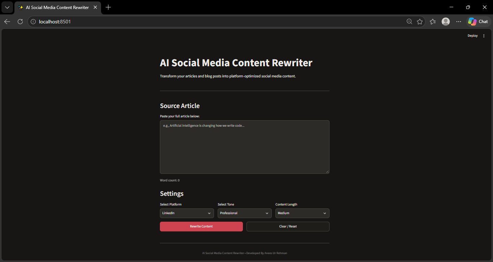

# AI Social Media Content Rewriter

## Description
AI Social Media Content Rewriter converts articles and blog posts into platform tailored social media posts for Twitter, LinkedIn, and newsletters. It is built for content creators, digital marketers, and writers looking to adapt long text into platform specific formats.

## Live Demo
https://social-media-content-rewriter.streamlit.app/

## Tech Stack
- Python
- Streamlit
- Google Gemini API
- python-dotenv

## Getting Started

### Prerequisites
Python 3.10 or higher must be installed on your computer.

### 1. Clone the repository
```bash
git clone https://github.com/aneesofficial/Social-Media-Content-Rewriter.git
cd Social-Media-Content-Rewriter
```

### 2. Install dependencies
```bash
pip install -r requirements.txt
```

### 3. Run the application
```bash
streamlit run app.py
```

Open your browser and navigate to:
http://localhost:8501

## Environment Variables
Create a .env file in the root directory:
```env
GEMINI_API_KEY=AIzaSyDexampleKey123456789
GEMINI_MODEL=gemini-3.6-flash
```

## Screenshots

